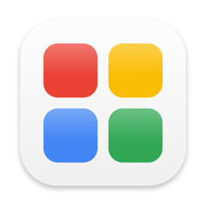
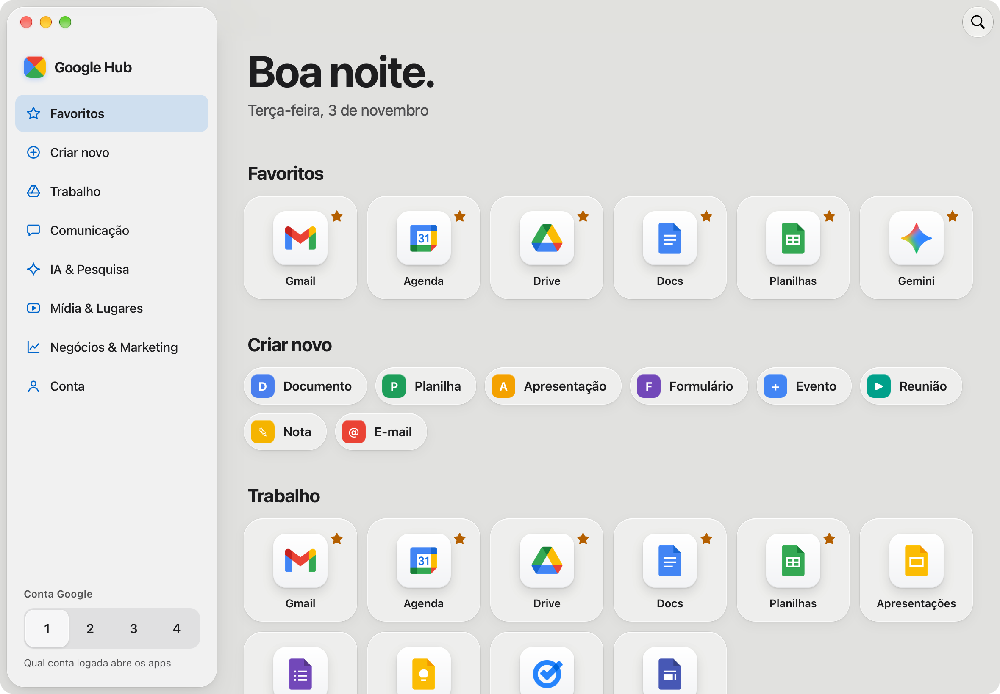
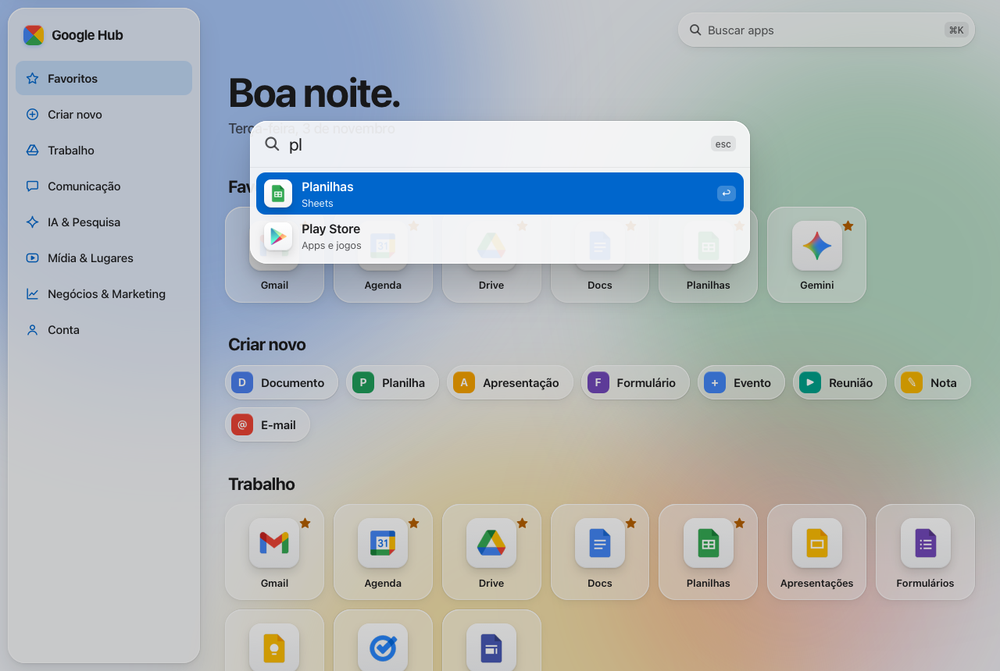
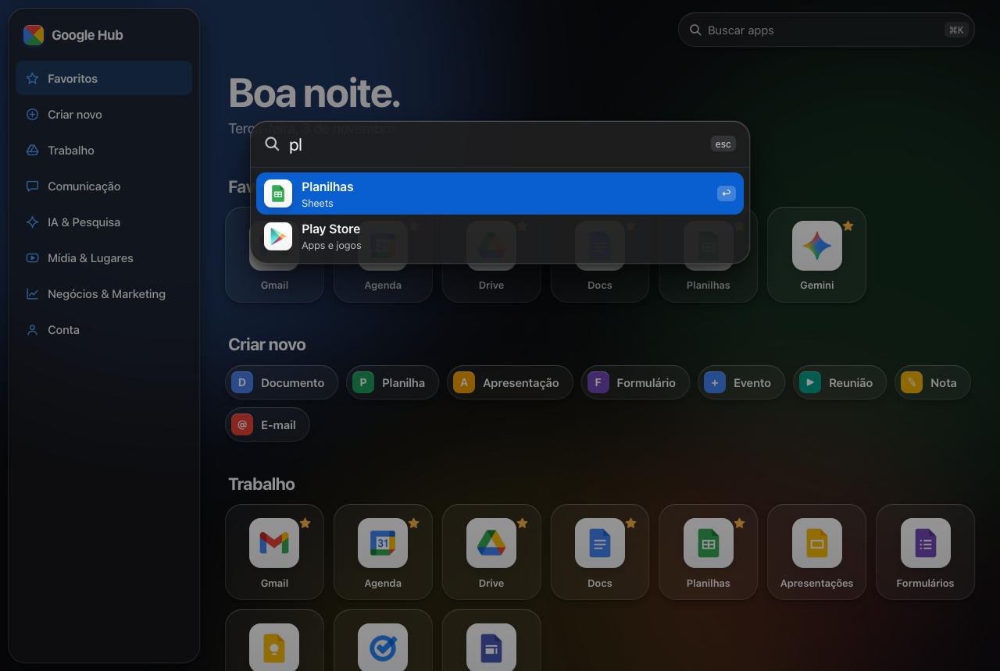

<div align="center">



# Google Hub

**Todos os apps do Google num só lugar, com cara de Mac.**

Um launcher nativo para macOS com vidro de verdade, busca estilo Spotlight e atalhos de teclado.<br>
Cada app abre numa aba do Safari.

[](https://github.com/Rodrigo1451/google-hub/actions/workflows/test.yml)


</div>

<picture>
  <source media="(prefers-color-scheme: dark)" srcset="docs/screenshots/app-dark.png">
  
</picture>

## ✨ Vibecoded

Este projeto foi feito **inteiro numa conversa com o [Claude Code](https://claude.com/claude-code)**: eu descrevia o que queria em português ("quero um app no meu Mac pra abrir tudo do Google", "deixa mais com cara de Apple, mais glass", "os botões da janela estão jogados em cima do design") e a IA planejava, escrevia o código, os testes, tirava screenshots pra conferir e corrigia.

Não escrevi uma linha de código na mão. O plano de implementação que guiou o trabalho está em [`docs/superpowers/plans/`](docs/superpowers/plans/2026-11-02-google-hub-glass-redesign.md), e o histórico de commits conta a evolução do zero até aqui.

Mesmo vibecodado, não é gambiarra: tem **99 testes automatizados** rodando a cada commit no GitHub Actions, auditoria de acessibilidade com axe e revisão de código independente.

## O que ele faz

- **37 apps do Google** organizados em seções: Trabalho, Comunicação, IA & Pesquisa, Mídia & Lugares, Negócios & Marketing e Conta.
- **Criar novo com um clique:** documento, planilha, apresentação, formulário, evento, reunião, nota e e-mail.
- **Favoritos:** passe o mouse e clique na estrela (ou pressione **F**). Reordene com **⌥←** / **⌥→**.
- **Busca estilo Spotlight (⌘K):** ignora acentos, entende português e inglês ("agenda", "AGÊNDA" e "calendar" acham o mesmo app) e aceita várias palavras ("you music").
- **Várias contas Google:** escolha no rodapé da barra lateral (1 a 4) qual conta logada abre os apps. Os links ganham `?authuser=N` automaticamente.
- **Tudo abre no Safari,** nunca dentro do app.

<table>
<tr>
<td></td>
<td></td>
</tr>
</table>

## Design

Seguindo as diretrizes da Apple (com a skill [`apple-design`](https://github.com/emilkowalski/skills)):

- **Vidro de verdade:** o fundo da janela é o material translúcido do macOS (`NSVisualEffectView`), que desfoca o seu papel de parede. Por cima, superfícies de vidro em três espessuras (fina, regular, grossa), e quanto maior a superfície, mais desfoque e mais sombra.
- **Janela nativa:** barra de ferramentas unificada, botões da janela dentro da barra lateral flutuante e busca na barra de ferramentas.
- **Tipografia do sistema** (SF Pro), com espaçamento entre letras ajustado ao tamanho.
- **Movimento:** a busca "materializa" a partir do topo e sai pelo mesmo caminho, e os botões respondem no instante do clique.
- **Modo claro e escuro** automáticos.

## Acessibilidade

- **Zero violações no axe** (WCAG 2.2 AA) nos modos claro, escuro, com contraste aumentado e com transparência reduzida.
- **Navegação completa pelo teclado:** setas, Home e End nas grades, Tab com uma parada por grade e link para pular ao conteúdo. Funciona até no Safari, que por padrão pula links no Tab.
- **Leitores de tela:** rótulos descritivos ("Abrir Gmail em nova aba") e anúncios ao favoritar.
- **Respeita os ajustes do Mac:** reduzir movimento, reduzir transparência e aumentar contraste.
- **Alvos de clique** com pelo menos 44 × 44 pt.

## Atalhos

| Atalho | Ação |
|---|---|
| <kbd>⌘K</kbd> ou <kbd>⌘F</kbd> ou <kbd>/</kbd> | Buscar apps |
| <kbd>↑</kbd> <kbd>↓</kbd> + <kbd>↩</kbd> | Escolher e abrir na busca |
| <kbd>←</kbd> <kbd>↑</kbd> <kbd>→</kbd> <kbd>↓</kbd> <kbd>Home</kbd> <kbd>End</kbd> | Navegar entre os apps |
| <kbd>Espaço</kbd> ou <kbd>↩</kbd> | Abrir o app focado |
| <kbd>F</kbd> | Favoritar o app focado |
| <kbd>⌥←</kbd> <kbd>⌥→</kbd> | Reordenar favoritos |
| <kbd>⌘R</kbd> | Recarregar |

## Instalar

Precisa de macOS 13 ou mais novo e das ferramentas de linha de comando do Xcode (`xcode-select --install`).

```bash
git clone https://github.com/Rodrigo1451/google-hub.git ~/GoogleHub
cd ~/GoogleHub
bash scripts/build-app.sh      # baixa os logos, compila e instala em ~/Applications
open ~/Applications/"Google Hub.app"
```

Depois, clique com o botão direito no ícone do Dock e escolha **Opções › Manter no Dock**.

> Os logos não fazem parte do repositório. O `build-app.sh` baixa os ícones oficiais direto dos servidores do Google, para uso pessoal. Apps sem logo usam um ícone desenhado.

Prefere sem app? Abra o `index.html` direto no Safari: funciona igual, com um fundo colorido no lugar do vidro do sistema.

## Como funciona

```
native/GoogleHub.swift   App AppKit: janela com vidro, WKWebView transparente, toolbar e
                         roteamento de links (http/https/mailto → Safari)
index.html               Página (sem build, sem servidor, roda de file://)
css/tokens.css           Materiais de vidro, cores, tipografia e overrides de acessibilidade
css/app.css              Componentes
js/catalog.js            Catálogo de apps, atalhos de criação e ícones
js/search.js             Busca com ranking, sem acentos
js/favorites.js          Favoritos (localStorage, à prova de dados corrompidos)
js/accounts.js           Conta Google ativa (?authuser=N)
js/ui.js, grid-nav.js,   Renderização, navegação por teclado e a busca estilo Spotlight
  palette.js
scripts/                 Baixar logos, compilar o app
tests/                   Testes unitários (node:test) e de interface (Playwright WebKit + axe)
```

## Testes

```bash
npm install && npx playwright install webkit
npm test                                                      # 45 unitários + 54 de interface
~/Applications/"Google Hub.app"/Contents/MacOS/GoogleHub --selftest   # testa o app nativo
```

A CI ([`.github/workflows/test.yml`](.github/workflows/test.yml)) roda tudo isso num Mac do GitHub a cada push, inclusive compilar o app e rodar o self-test.

O `--selftest` abre a janela de verdade, confere a página, mede a posição dos botões da janela em relação à barra lateral e valida o roteamento de links. Com `--snapshot arquivo.png` ele também fotografa a janela.

## Aviso

Projeto pessoal e não oficial, sem qualquer vínculo com o Google ou a Apple. Google, Gmail, Google Drive, YouTube e os demais nomes e logos são marcas registradas da Google LLC. O app só abre os sites oficiais no seu navegador: não acessa sua conta nem coleta dados.

## Licença

[MIT](LICENSE). O código é seu para usar, aprender e remixar. As marcas citadas acima continuam sendo dos seus donos.
